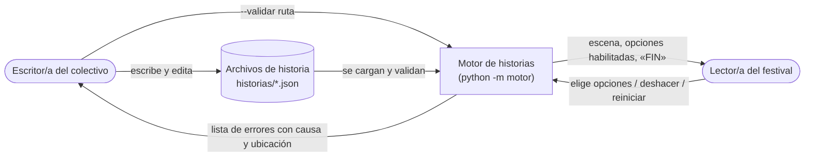
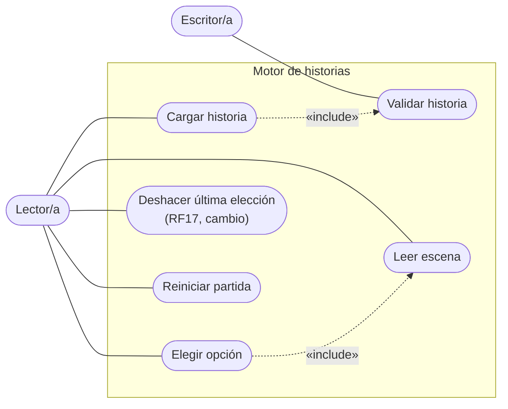
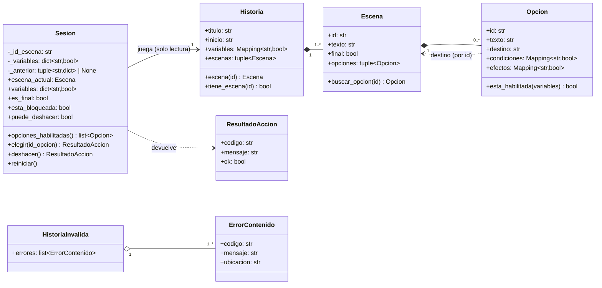
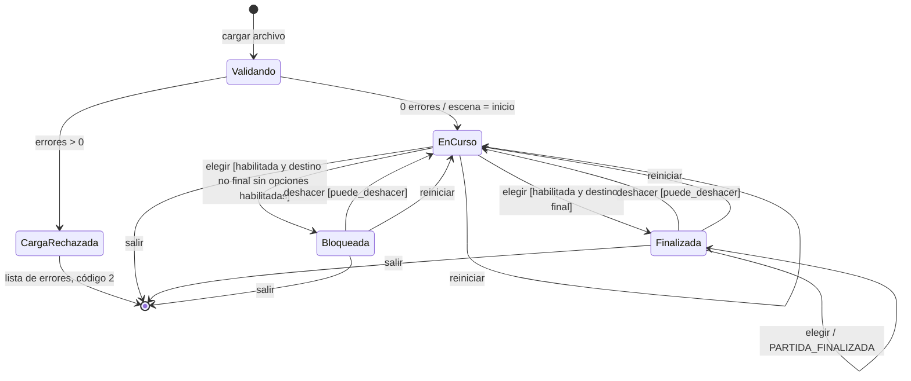
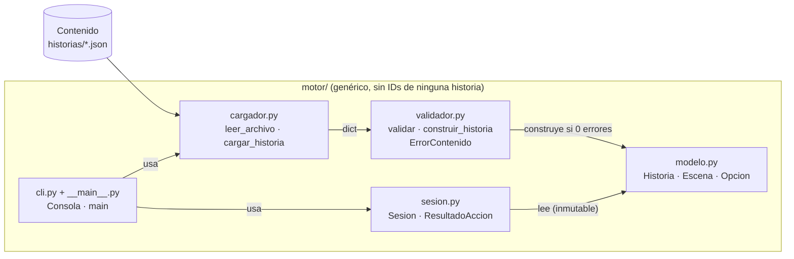

# Anexo — Diagramas, matriz de trazabilidad y tablero

Referenciado desde el informe. Contiene solo diagramas, la matriz y las capturas del tablero.
Generado con `python scripts/generar_anexo.py` desde `docs/modelos.md`, `docs/arquitectura.md` y `docs/trazabilidad.md`.

## A. Modelos

### A.1 Contexto



### A.2 Casos de uso



### A.3 Clases del dominio



### A.4 Secuencia «elegir una opción»

```mermaid
sequenceDiagram
    actor Lector
    participant C as Consola (cli.py)
    participant S as Sesion
    participant E as Escena actual
    participant O as Opcion

    Lector->>C: escribe "2" o "investigar"
    C->>S: opciones_habilitadas() (si es número)
    C->>S: elegir(id_opcion)
    alt la escena es final
        S-->>C: ResultadoAccion(PARTIDA_FINALIZADA)
    else
        S->>E: buscar_opcion(id_opcion)
        E-->>S: Opcion o None
        alt no existe
            S-->>C: ResultadoAccion(OPCION_INEXISTENTE)
        else existe
            S->>O: esta_habilitada(variables)
            alt condiciones no cumplidas
                S-->>C: ResultadoAccion(OPCION_NO_HABILITADA)
            else habilitada
                S->>S: nuevas = copia(variables) + efectos
                S->>S: _anterior = (escena, copia(variables))  [cambio RF17]
                S->>S: escena = destino; variables = nuevas
                S-->>C: ResultadoAccion(OK)
            end
        end
    end
    C-->>Lector: mensaje de rechazo (estado intacto) o nueva escena
```

### A.5 Estados de una sesión



## B. Arquitectura: componentes y capas



## C. Matriz de trazabilidad
Versión: `v2-cambio`. Modelos en [modelos.md](modelos.md): **CTX** contexto, **CU** casos de uso, **CL** clases, **SEC** secuencia «elegir una opción», **EST** estados de la sesión.
Pruebas como `archivo::función` dentro de `tests/`. Evidencia común de ejecución: `evidencias/resultados_pruebas.txt`.

| Requisito | Necesidad | Modelo(s) | Archivo / función | Prueba(s) | Evidencia |
|---|---|---|---|---|---|
| RF01 Cargar historia desde archivo | N01 | CTX, CU «Cargar historia» | `motor/cargador.py::cargar_historia`, `leer_archivo`; `motor/cli.py::_ejecutar` | `test_validacion.py::test_U4_historias_validas_no_producen_errores`; `test_integracion.py::test_I1_archivo_oficial_recorre_hasta_cada_final` | `evidencias/resultados_pruebas.txt` |
| RF02 Inicio y variables iniciales | N01 | CL `Historia`, `Sesion`; EST `Validando → EnCurso` | `motor/sesion.py::Sesion.__init__` | `test_deshacer.py::test_U6_al_comenzar_no_hay_retroceso`; `test_integracion.py::test_I1_archivo_oficial_recorre_hasta_cada_final` | `evidencias/resultados_pruebas.txt` |
| RF03 Mostrar escena y opciones | N02 | CU «Leer escena» | `motor/cli.py::Consola.mostrar_escena` | `test_cli.py::test_cli_muestra_titulo_escena_y_opciones_numeradas` | `evidencias/resultados_pruebas.txt` |
| RF04 Solo opciones habilitadas (CA01) | N02 | CL `Opcion.esta_habilitada`; SEC | `motor/modelo.py::Opcion.esta_habilitada`; `motor/sesion.py::Sesion.opciones_habilitadas` | `test_sesion.py::test_U1_condiciones_habilitan_solo_las_opciones_correspondientes_en_E3`, `test_U1_CA01_revisar_e_investigar_muestra_activar_con_codigo_y_cortar`, `test_U1_todas_las_condiciones_deben_cumplirse` | `evidencias/resultados_pruebas.txt` |
| RF05 Elegir aplica efectos y destino | N03 | CU «Elegir opción»; SEC; EST `elegir` | `motor/sesion.py::Sesion.elegir`; `motor/cli.py::Consola.procesar` | `test_sesion.py::test_U2_eleccion_valida_aplica_efectos_y_avanza_al_destino`, `test_U2_efectos_vacios_conservan_las_variables`, `test_U2_cada_opcion_de_E3_lleva_a_su_final_con_su_efecto`; `test_cli.py::test_cli_acepta_numero_o_id_y_muestra_FIN` | `evidencias/resultados_pruebas.txt` |
| RF06 Rechazo sin alterar estado (CA02) | N03 | SEC (ramas `alt`); EST `elegir [inexistente o no habilitada]` | `motor/sesion.py::Sesion.elegir`; `motor/modelo.py::Escena.buscar_opcion` | `test_sesion.py::test_U3_opcion_inexistente_deja_intacto_el_estado`, `test_U3_CA02_activar_codigo_sin_conocer_origen_se_rechaza`; `test_deshacer.py::test_U6_entrada_invalida_preserva_el_historial`; `test_cli.py::test_cli_entradas_invalidas_se_informan_sin_cambiar_la_partida` | `evidencias/resultados_pruebas.txt` |
| RF07 Estado durante la partida | N04 | CL `Sesion._variables`, `variables` | `motor/sesion.py::Sesion.variables`; `motor/cli.py::Consola.mostrar_estado` | `test_sesion.py::test_U1_CA01_*`, `test_U3_variables_expuestas_son_copia_y_la_historia_no_cambia`; `test_cli.py::test_cli_reiniciar_estado_y_ayuda` | `evidencias/resultados_pruebas.txt` |
| RF08 Finales y «FIN» | N05 | EST `Finalizada` | `motor/sesion.py::Sesion.es_final`, `elegir`; `motor/cli.py::Consola.mostrar_escena` | `test_sesion.py::test_U3_elegir_en_un_final_devuelve_partida_finalizada`; `test_integracion.py::test_I1_archivo_oficial_recorre_hasta_cada_final`; `test_cli.py::test_cli_acepta_numero_o_id_y_muestra_FIN` | `evidencias/resultados_pruebas.txt` |
| RF09 Reiniciar | N05 | CU «Reiniciar partida»; EST `reiniciar` | `motor/sesion.py::Sesion.reiniciar` | `test_sesion.py::test_U5_reiniciar_restaura_escena_y_variables_iniciales`, `test_U5_reiniciar_no_conserva_informacion_de_la_partida_anterior`, `test_U5_extendido_reiniciar_elimina_el_historial_de_deshacer` | `evidencias/resultados_pruebas.txt` |
| RF10 Archivo legible, estructura y campos | N06 | CU «Validar historia»; CL `ErrorContenido`; EST `CargaRechazada` | `motor/cargador.py::leer_archivo`; `motor/validador.py::_Validador.campos`, `ejecutar` | `test_validacion.py::test_U4_contenido_invalido_se_rechaza_con_codigo_causa_y_ubicacion[ilegible_*, estructura_*, campo_faltante_*]` | `evidencias/rnf/resultado_rnf.txt` (RNF-02) |
| RF11 Inicio y destinos existentes (CA03) | N06 | CU «Validar historia»; EST `CargaRechazada` | `motor/validador.py::_Validador.ejecutar`, `validar_opcion` | `test_validacion.py::test_U4_*[inicio_inexistente, destino_inexistente_CA03]`; `test_rnf.py::test_RNF02_CA03_jugar_un_destino_inexistente_no_abre_la_partida` | `historias/invalidas/destino_inexistente.json`; `evidencias/rnf/resultado_rnf.txt` |
| RF12 IDs únicos en su ámbito | N06 | CU «Validar historia» | `motor/validador.py::_Validador.recolectar_ids_escenas`, `validar_opcion` | `test_validacion.py::test_U4_*[escena_duplicada, opcion_duplicada]` | `evidencias/rnf/resultado_rnf.txt` |
| RF13 Variables declaradas y booleanas | N06 | CU «Validar historia» | `motor/validador.py::_Validador.ejecutar`, `validar_opcion` | `test_validacion.py::test_U4_*[variable_no_declarada_*, valor_no_booleano_*]`, `test_U4_valores_parecidos_a_booleanos_se_rechazan` | `evidencias/rnf/resultado_rnf.txt` |
| RF14 Opciones coherentes con `final` | N06 | CU «Validar historia» | `motor/validador.py::_Validador.validar_escena` | `test_validacion.py::test_U4_*[final_con_opciones, no_final_sin_opciones]` | `evidencias/rnf/resultado_rnf.txt` |
| RF15 Informe completo antes de jugar, `--validar` | N06 | CTX; CU «Validar historia»; EST `Validando → CargaRechazada` | `motor/validador.py::validar`, `construir_historia`, `HistoriaInvalida`; `motor/cli.py::imprimir_errores`, `cargar_o_informar`, `main` | `test_validacion.py::test_U4_se_informan_todos_los_errores_a_la_vez`, `test_U4_historia_invalida_no_abre_sesion_jugable`, `test_U4_los_casos_cubren_los_diez_codigos_de_error`; `test_cli.py::test_cli_validar_historia_valida` | `evidencias/rnf/resultado_rnf.txt` |
| RF16 Bloqueo en tiempo de ejecución | N03, N05 | EST `Bloqueada` | `motor/sesion.py::Sesion.esta_bloqueada`; `motor/cli.py::Consola.mostrar_escena` | `test_sesion.py::test_bloqueo_escena_no_final_sin_opciones_habilitadas`, `test_bloqueo_reiniciar_sale_del_bloqueo`, `test_bloqueo_deshacer_vuelve_a_la_escena_anterior`; `test_cli.py::test_cli_informa_bloqueo_y_permite_reiniciar` | `evidencias/resultados_pruebas.txt` |
| **RF17 Deshacer (cambio)** | N03, N04, N05 | CU «Deshacer»; CL `Sesion._anterior`, `deshacer`, `puede_deshacer`; SEC (instantánea); EST transiciones `deshacer` | `motor/sesion.py::Sesion.deshacer`, `puede_deshacer`, `elegir`, `reiniciar`; `motor/cli.py::Consola.ejecutar_comando`, `comandos_disponibles` | `test_deshacer.py::test_U6_*` (12 ejecuciones); `test_sesion.py::test_U5_extendido_reiniciar_elimina_el_historial_de_deshacer`; `test_integracion.py::test_I1_extendido_deshacer_desde_cada_final_tras_cargar_el_archivo`, `test_I1_segunda_historia_deshacer_desde_un_final`; `test_cli.py::test_cli_deshacer_*` | `evidencias/resultados_pruebas.txt`; `docs/analisis_impacto_cambio.md`; etiqueta `v2-cambio` |
| RNF-01 Modificabilidad | N01 | Arquitectura §3 | `historias/el_faro.json`; todo `motor/`; `scripts/verificar_rnf.py::rnf01` | `test_rnf.py::test_RNF01_segunda_historia_cumple_el_tamano_minimo`, `test_RNF01_todos_los_finales_son_alcanzables_con_el_mismo_motor`, `test_RNF01_el_motor_no_contiene_ids_ni_variables_de_las_historias`, `test_RNF01_agregar_la_segunda_historia_no_cambio_lineas_del_motor`; `test_integracion.py::test_I1_segunda_historia_*` | `evidencias/rnf/resultado_rnf.txt` |
| RNF-02 Claridad de errores | N06 | CL `ErrorContenido` | `motor/validador.py`; `motor/cargador.py`; `motor/cli.py::main`; `scripts/verificar_rnf.py::rnf02` | `test_rnf.py::test_RNF02_validar_por_consola_da_mensaje_con_id_y_sin_traceback` (21 casos), `test_RNF02_CA03_*`, `test_RNF02_jugar_por_consola_hasta_un_final_sin_traceback` | `evidencias/rnf/resultado_rnf.txt` |
| RNF-03 Confiabilidad | N03, N04 | EST (invariantes) | `motor/sesion.py::Sesion`; `scripts/verificar_rnf.py::secuencias_aleatorias`, `invariantes` | `test_rnf.py::test_RNF03_mil_secuencias_aleatorias_sin_excepciones_ni_violaciones[oficial, el_faro]` | `evidencias/rnf/resultado_rnf.txt` |

### C. Cobertura de necesidades

| Necesidad | RF |
|---|---|
| N01 | RF01, RF02 (y RNF-01) |
| N02 | RF03, RF04 |
| N03 | RF05, RF06, RF16, RF17 |
| N04 | RF07, RF17 |
| N05 | RF08, RF09, RF16, RF17 |
| N06 | RF10–RF15 |

### C. Escenarios de prueba mínimos de la guía

| Escenario | Prueba(s) |
|---|---|
| U1 | `test_sesion.py::test_U1_*` |
| U2 | `test_sesion.py::test_U2_*` |
| U3 | `test_sesion.py::test_U3_*` |
| U4 | `test_validacion.py::test_U4_*` |
| U5 (extendido) | `test_sesion.py::test_U5_*` |
| U6 (nuevo) | `test_deshacer.py::test_U6_*` |
| I1 (extendido) | `test_integracion.py::test_I1_*` |

## D. Tablero

### D.1 Captura inicial

[COMPLETAR: insertar `evidencias/tablero/tablero_inicial.png` (fecha y hora visibles)]

### D.2 Captura final

[COMPLETAR: insertar `evidencias/tablero/tablero_final.png` (fecha y hora visibles)]
