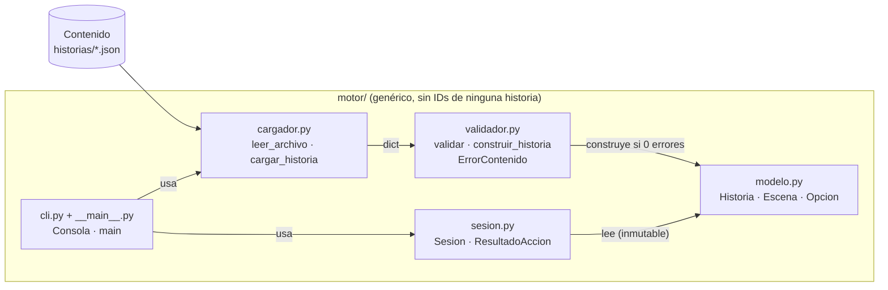

# Arquitectura

## 1. Componentes y capas

| Componente | Responsabilidad | Depende de |
|---|---|---|
| Contenido (`historias/*.json`) | Escenas, opciones, condiciones, efectos y estado inicial de cada relato. Lo editan los escritores. | — |
| `cargador.py` | Leer el archivo y convertirlo en un diccionario; traducir archivo inexistente, ilegible, no UTF-8 o JSON roto a `ARCHIVO_ILEGIBLE`. | `validador` |
| `validador.py` | Aplicar el contrato de contenido, recopilar **todos** los errores (`ErrorContenido`: código, mensaje, ubicación) y construir el modelo solo si no hay ninguno. | `modelo` |
| `modelo.py` | Representar `Historia`, `Escena` y `Opcion` como objetos inmutables; evaluar `condiciones` (`Opcion.esta_habilitada`). | — |
| `sesion.py` | Reglas de la partida: estado, opciones habilitadas, elegir, rechazar, finales, bloqueo, reiniciar y deshacer. Sin entrada/salida. | `modelo` |
| `cli.py` | Adaptador de consola: mostrar escenas, interpretar números/IDs/comandos, imprimir errores y códigos de salida; capturar EOF, Ctrl+C y cualquier excepción. Único módulo con `input`/`print`. | `cargador`, `sesion` |

Las dependencias van en un solo sentido (de la interfaz hacia el modelo); el modelo y la sesión no conocen la consola.

## 2. Decisiones de arquitectura

### AD-1. Validar todo antes de jugar

- **Contexto**: N06 y la coordinadora piden saber qué corregir **antes** de que alguien juegue y que el lector nunca encuentre un cierre inesperado. CA03 exige que un destino inexistente impida abrir la sesión.
- **Alternativas**: (a) validación completa al cargar; (b) validación perezosa durante la partida (comprobar un destino solo cuando se elige); (c) validar solo la sintaxis JSON y confiar en el escritor.
- **Elección**: (a). `construir_historia` recorre todo el archivo, acumula todos los errores y lanza `HistoriaInvalida` sin crear el modelo; la CLI los lista y sale con código 2.
- **Consecuencias**: (+) un error en una rama poco visitada se detecta igual; el escritor ve todos los problemas en una sola ejecución; la `Sesion` puede suponer un modelo consistente y no necesita comprobaciones defensivas. (−) El validador debe tolerar cualquier forma de entrada sin fallar (se resolvió comprobando tipos antes de acceder a campos, verificado por RNF-02/U4); no se detectan problemas de la lógica narrativa (p. ej., finales inalcanzables), fuera de alcance según la guía.

### AD-2. Deshacer con una única instantánea

- **Contexto**: la solicitud de cambio exige deshacer solo la última elección válida, restaurando escena y **todas** las variables, sin rehacer, y sin que las entradas inválidas afecten el historial. No exige un patrón concreto.
- **Alternativas**: (a) una instantánea `(id_escena, copia de variables)`; (b) una pila de instantáneas (historial completo); (c) patrón Command con operaciones inversas por efecto; (d) guardar la lista de elecciones y reproducirlas desde el inicio menos la última.
- **Elección**: (a). `Sesion._anterior` se guarda justo antes de confirmar una elección que superó todas las validaciones; `deshacer` la restaura (como copia) y la pone en `None`; `reiniciar` también.
- **Consecuencias**: (+) cumple las cinco reglas con ~15 líneas y sin tocar el modelo, el validador ni el contenido; las variables son pocas booleanas, así que copiar el mapa es barato; la regla «un solo nivel» es estructural (no hay dónde guardar un segundo nivel). (−) Si el cliente pidiera retroceso ilimitado o rehacer, habría que cambiar a (b); (c) sería más complejo porque un efecto que asigna el mismo valor no tiene inverso evidente; (d) depende de que el contenido sea determinista y es más costoso.

## 3. Separación entre contenido, reglas e interfaz

- **Contenido** (`historias/`): todo lo específico de un relato — IDs, textos, variables, condiciones, efectos — está en JSON.
- **Reglas** (`modelo.py`, `sesion.py`, `validador.py`): interpretan cualquier historia que cumpla el contrato. No contienen ningún ID de escena/opción ni nombre de variable: lo comprueba `tests/test_rnf.py::test_RNF01_el_motor_no_contiene_ids_ni_variables_de_las_historias`.
- **Interfaz** (`cli.py`): solo traduce entre el teclado y la `Sesion`.
- **Demostración**: `historias/el_faro.json` (5 escenas, IDs `faro_*`, variables `tiene_llave` y `lampara_encendida`, 2 condiciones, 3 efectos, 2 finales) se agregó en el commit `7688ab1` sin cambiar ninguna línea de `motor/` (medido por `scripts/verificar_rnf.py`) y se juega hasta todos sus finales (`test_RNF01_todos_los_finales_son_alcanzables_con_el_mismo_motor`, `test_I1_segunda_historia_*`).

## 4. Decisión de diseño detallado: `Sesion` sin entrada/salida

- **Decisión**: `Sesion` no llama a `input` ni a `print`; devuelve `ResultadoAccion(codigo, mensaje)` y expone propiedades (`escena_actual`, `variables`, `es_final`, `esta_bloqueada`, `puede_deshacer`). `Consola` recibe funciones `entrada`/`salida` inyectables.
- **Motivo**: bajo acoplamiento y alta cohesión; las reglas se prueban directamente con códigos estables (U1–U6, I1, RNF-03 ejecuta 100 000 acciones en pocos segundos) sin simular el teclado, y la consola se prueba con entradas simuladas (`tests/test_cli.py`).
- **Consecuencia**: el cambio de la hora 6 tocó `sesion.py` (regla) y añadió un comando en `cli.py` (adaptador) sin que uno dependa del otro; otra interfaz (web, escritorio) podría reutilizar `Sesion` sin cambios.
- **Otra decisión relacionada**: `variables` devuelve siempre una **copia** y el modelo es inmutable, de modo que ningún cliente puede alterar el estado por referencia (`test_U3_variables_expuestas_son_copia_y_la_historia_no_cambia`, `test_U6_la_instantanea_es_una_copia_y_no_una_referencia`).

## 5. Bibliotecas y licencias

| Componente | Versión usada | Uso | Licencia |
|---|---|---|---|
| Python (incluye `json`, `dataclasses`, `pathlib`, `random`, `subprocess`, `zipfile`) | 3.10.11 (requiere ≥ 3.10) | lenguaje y biblioteca estándar | PSF License |
| pytest | 9.1.1 (`pytest>=7`) | pruebas automatizadas | MIT |
| Dependencias de pytest instaladas por pip | pluggy 1.6.0, iniconfig 2.3.1, packaging 26.3, colorama 0.4.6, exceptiongroup 1.3.1, tomli 2.5.0, Pygments 2.21.0 | solo para ejecutar las pruebas | MIT; MIT; Apache-2.0 o BSD-2-Clause; BSD; MIT; MIT; BSD-2-Clause |

El motor en ejecución solo usa la biblioteca estándar de Python.
