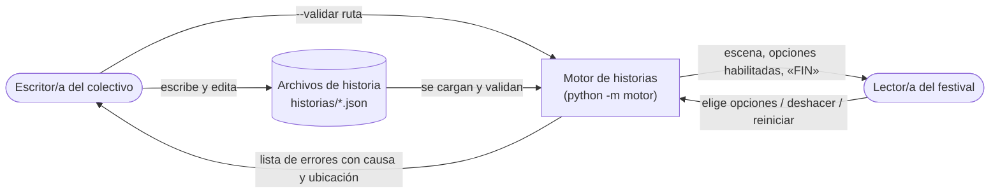
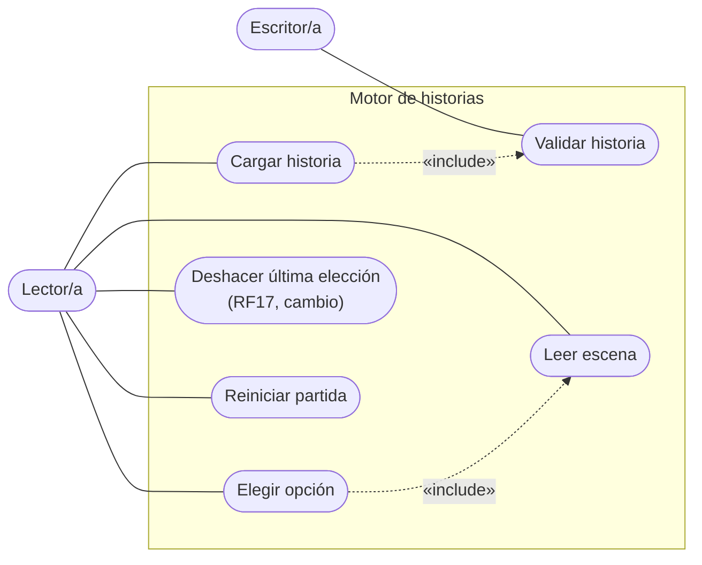
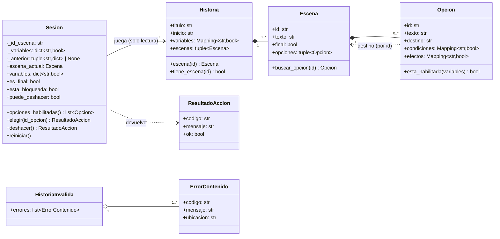
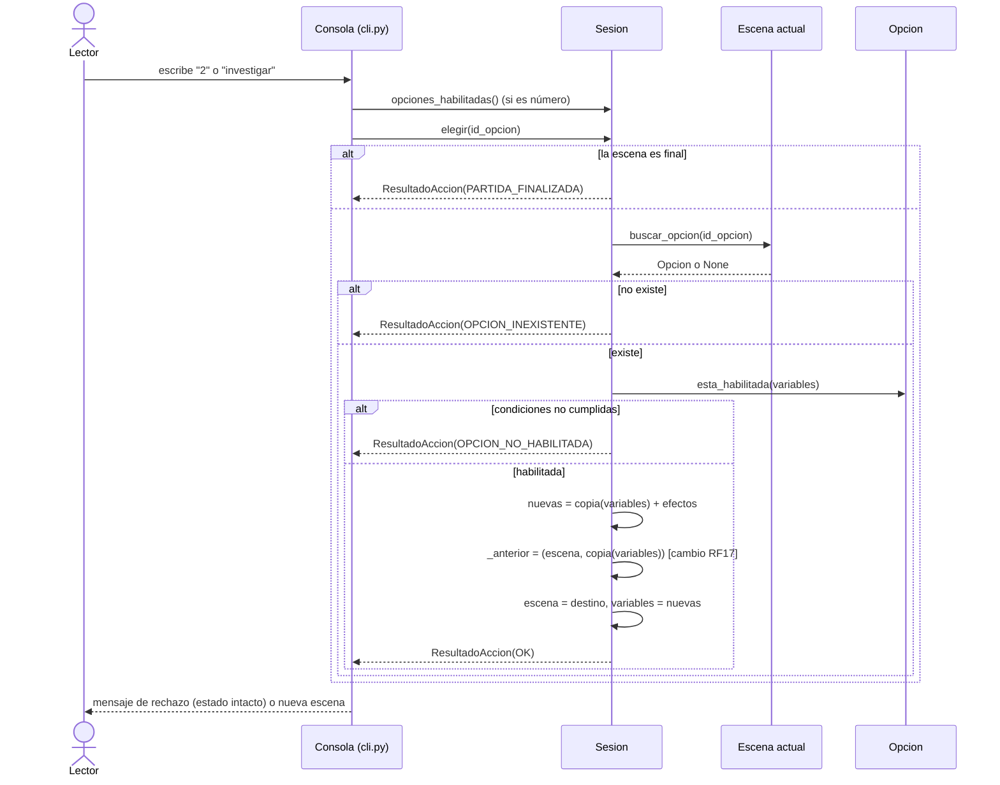
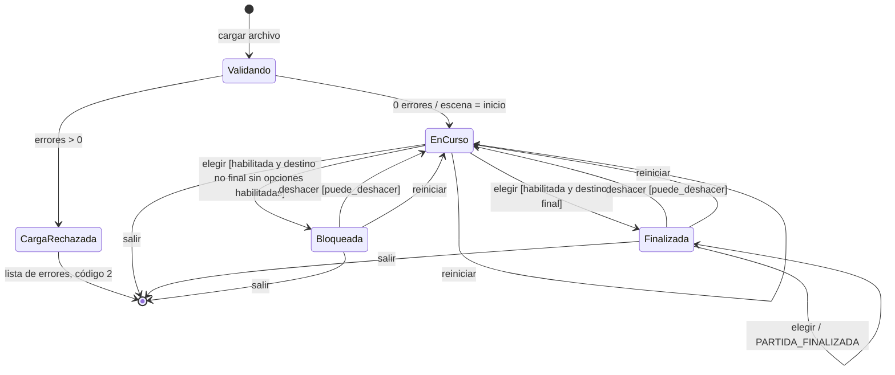

# Modelos del software

Diagramas en Mermaid (se ven directamente en GitHub/VS Code; para exportar a imagen: <https://mermaid.live>).
Los nombres coinciden con el código de la versión `v2-cambio`.

## 1. Contexto

## 2. Casos de uso

| Caso de uso | Actor | RF |
|---|---|---|
| Cargar historia | Lector | RF01, RF02 |
| Validar historia | Escritor (y Cargar, por inclusión) | RF10–RF15 |
| Leer escena | Lector | RF03, RF04, RF08, RF16 |
| Elegir opción | Lector | RF05, RF06, RF07 |
| Deshacer última elección | Lector | RF17 |
| Reiniciar partida | Lector | RF09 |

## 3. Clases del dominio

`Historia`, `Escena` y `Opcion` son inmutables (dataclasses `frozen`, mapas de solo lectura). `_anterior` es la instantánea de un nivel agregada por el cambio.

## 4. Secuencia «elegir una opción»

Una entrada rechazada no toca `escena`, `variables` ni `_anterior`.

## 5. Estados de una sesión

Deshacer siempre lleva a `EnCurso`: la escena restaurada tenía al menos una opción habilitada (la que se eligió) con las variables restauradas. Tras `deshacer` o `reiniciar`, `puede_deshacer` es falso.
